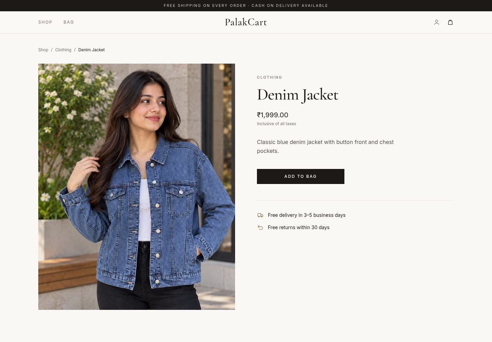

# PalakCart

A full-stack e-commerce store built with **Django REST Framework**, **React** and **PostgreSQL**.
Customers can browse and search products, manage a shopping bag, and check out; the store owner manages the catalogue and orders through the Django admin.

**🔗 Live demo: [ecommerce-django-react-xi.vercel.app](https://ecommerce-django-react-xi.vercel.app)**

Demo login: username `demo`, password `PalakCart@2026`. Or create your own account.

> The API runs on Render's free tier and sleeps when idle, so the first load can take up to a minute.


## Features

**Shopping**
- Product catalogue with category tabs, instant search and sorting by price or newest
- Product pages with breadcrumbs and "You may also like" recommendations from the same category
- Shopping bag with quantity controls and a live order summary
- Checkout with delivery details, payment choice and server-side validation; the order is created and the bag emptied in a single database transaction

**Accounts & security**
- Sign up and sign in with JWT authentication (access + refresh tokens)
- Expired access tokens are refreshed automatically and the request retried
- Cart and order endpoints are scoped to the signed-in user, so one user can never read or change another user's bag
- Secrets and environment-specific settings are loaded from `.env` files, never committed

**Admin & tooling**
- Django admin for products, categories, orders and users
- `seed_products` management command that creates 5 categories and 22 products with generated images in one step
- Responsive design that works from phones to wide desktops

## Screenshots

| Shop | Product page | Mobile |
|---|---|---|
|  |  |  |

## Tech stack

| Layer | Technology |
|---|---|
| Frontend | React 19, React Router 7, Tailwind CSS 4, Vite |
| Backend | Python, Django 5.2, Django REST Framework, Simple JWT |
| Database | PostgreSQL |
| Other | django-cors-headers, python-dotenv, Pillow |
| Hosting | Vercel (frontend), Render (API), Neon (PostgreSQL), Cloudinary (images) |

## Project structure

```
ecommerce_project/
├── backend/                  # Django project
│   ├── backend/              # settings, root URLs
│   ├── store/                # models, serializers, views, API URLs
│   │   └── management/commands/seed_products.py
│   ├── requirements.txt
│   └── .env.example
├── frontend/                 # React app (Vite)
│   ├── src/
│   │   ├── components/       # Navbar, Footer, ProductCard, OrderSummary, ...
│   │   ├── context/          # CartContext (global cart state)
│   │   ├── pages/            # Shop, ProductDetails, Cart, Checkout, Login, Signup
│   │   └── utils/            # auth (JWT + refresh), API URL, price formatting
│   └── .env.example
└── docs/screenshots/
```

## Getting started

### Prerequisites
- Python 3.10+
- Node.js 20.19+ (Node 22 recommended)
- PostgreSQL 14+

### 1. Clone the repository
```bash
git clone https://github.com/YOUR-USERNAME/palakcart.git
cd palakcart
```

### 2. Create the database
```bash
sudo -u postgres psql
```
```sql
CREATE DATABASE ecommerce_db;
CREATE USER ecommerce_user WITH PASSWORD 'choose-a-strong-password';
GRANT ALL PRIVILEGES ON DATABASE ecommerce_db TO ecommerce_user;
ALTER DATABASE ecommerce_db OWNER TO ecommerce_user;
\q
```

### 3. Set up the backend
```bash
python3 -m venv venv
source venv/bin/activate            # Windows: venv\Scripts\activate
pip install -r backend/requirements.txt

cd backend
cp .env.example .env                # then fill in the values (see below)
python manage.py migrate
python manage.py seed_products      # optional: sample categories and products
python manage.py createsuperuser    # account for the admin panel
python manage.py runserver
```
The API runs at http://127.0.0.1:8000 and the admin at http://127.0.0.1:8000/admin/.

### 4. Set up the frontend
In a second terminal:
```bash
cd frontend
cp .env.example .env                # set VITE_DJANGO_BASE_URL=http://127.0.0.1:8000
npm install
npm run dev
```
Open http://localhost:5173.

### Environment variables

**`backend/.env`**

| Variable | Example | Description |
|---|---|---|
| `DB_NAME` | `ecommerce_db` | PostgreSQL database name |
| `DB_USER` | `ecommerce_user` | PostgreSQL user |
| `DB_PASSWORD` | | PostgreSQL password |
| `DB_HOST` | `localhost` | Database host |
| `DB_PORT` | `5432` | Database port |
| `SECRET_KEY` | | Django secret key. Generate one with `python -c "from django.core.management.utils import get_random_secret_key; print(get_random_secret_key())"` |
| `DEBUG` | `True` | Use `False` in production |
| `ALLOWED_HOSTS` | `localhost,127.0.0.1` | Comma-separated hostnames |
| `CORS_ALLOWED_ORIGINS` | `http://localhost:5173,http://127.0.0.1:5173` | Frontend URLs allowed to call the API |

**`frontend/.env`**

| Variable | Example | Description |
|---|---|---|
| `VITE_DJANGO_BASE_URL` | `http://127.0.0.1:8000` | Base URL of the Django API |

## API reference

All endpoints are prefixed with `/api/`. Endpoints marked 🔒 need an `Authorization: Bearer <access token>` header.

| Method | Endpoint | Description |
|---|---|---|
| `POST` | `/register/` | Create an account (`username`, `email`, `password`, `password2`) |
| `POST` | `/token/` | Sign in, returns `access` and `refresh` tokens |
| `POST` | `/token/refresh/` | Exchange a refresh token for a new access token |
| `GET` | `/products/` | List all products |
| `GET` | `/products/<id>/` | Product details |
| `GET` | `/categories/` | List categories |
| `GET` | `/cart/` 🔒 | Current user's cart with items and total |
| `POST` | `/cart/add/` 🔒 | Add a product (`product_id`); increases quantity if already in the cart |
| `POST` | `/cart/update/` 🔒 | Set quantity (`item_id`, `quantity`); a quantity below 1 removes the item |
| `POST` | `/cart/remove/` 🔒 | Remove an item (`item_id`) |
| `POST` | `/orders/create/` 🔒 | Place an order from the cart (`name`, `address`, `phone`, `payment_method`: `COD` or `ONLINE`) |

## Management commands

```bash
python manage.py seed_products                   # add sample categories and products (skips existing ones)
python manage.py seed_products --refresh-images  # redraw the generated images of seeded products
python manage.py seed_products --clear           # delete ALL categories and products, then reseed
```

## Roadmap

- [ ] Online payments with Razorpay (test mode)
- [ ] Order history page and order status tracking
- [ ] Stock management with protection against overselling
- [ ] Server-side pagination and filtering
- [ ] Automated tests and GitHub Actions CI
- [ ] Docker Compose setup for local development

## Author

**Palak Bhati**
